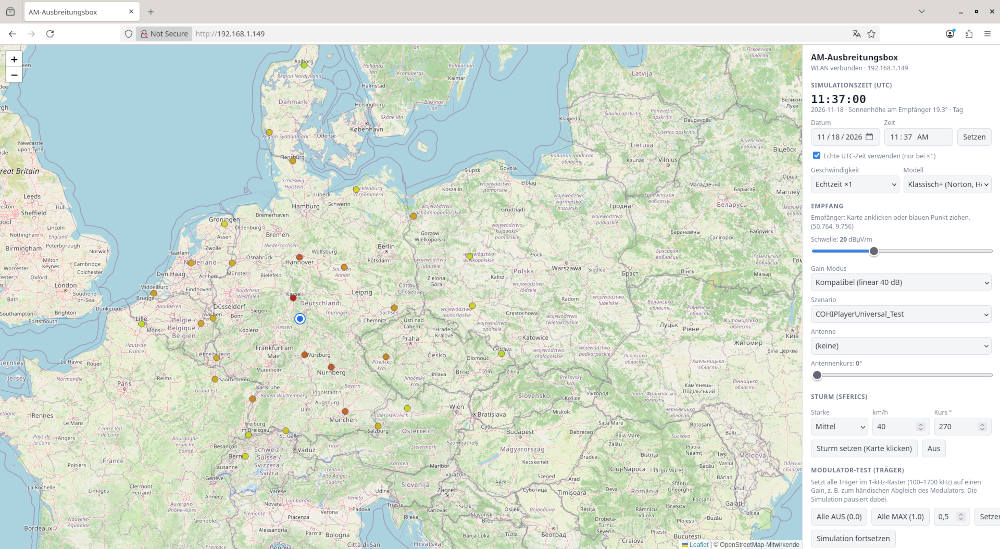
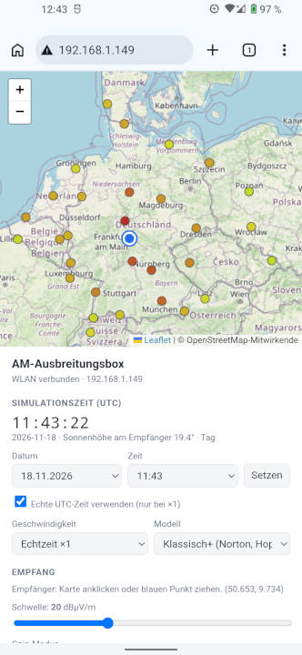
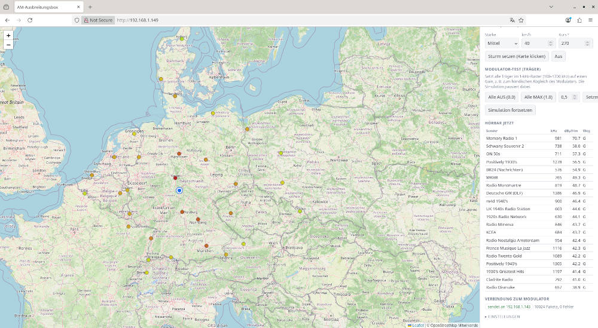
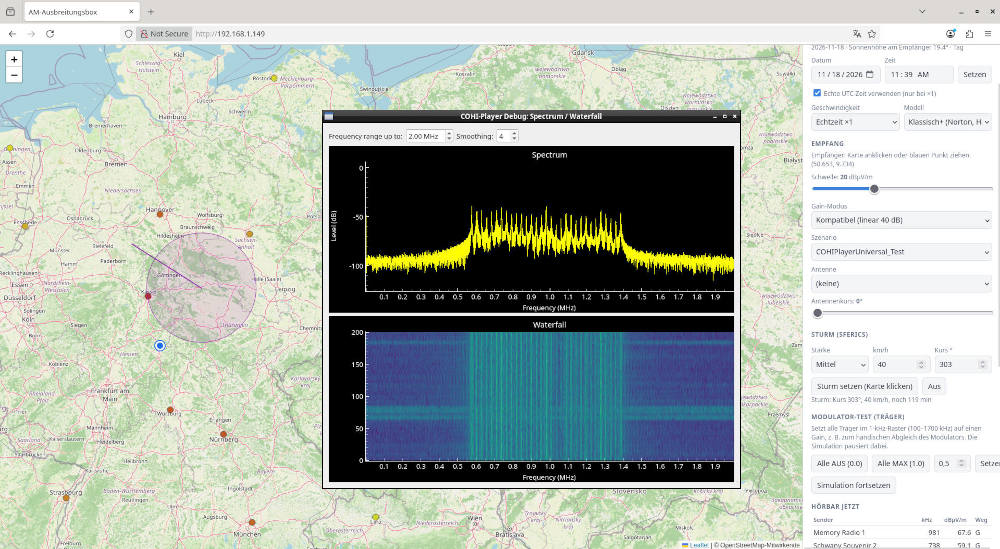

# AM Propagation Box – AM propagation simulation on a classic ESP32 (ESP-IDF 6.1)

🇩🇪 [Deutsche Version: README.de.md](README.de.md)

Port of the [AMWaveSynth Propagation Simulator](https://github.com/radiolab81/AMWaveSynthPropagationSimulator)
to a small, standalone **classic ESP32** (Wi-Fi only). The box simulates long-/medium-wave propagation
for **one receiver location** and drives **one modulator** (AMWaveSynth / COHI-Player-Universal, e.g. on a
headless Raspberry Pi 4/5 or PC) over UDP. Modulator and ESP32 sit in the same Wi-Fi network. Operation is
through a web interface with a map, a serial console, and optional jumpers / button / LED.

Based on transmitter data (location, power – e.g. from an old WRTH) the box computes ground wave and
sky wave at the receiver location for the chosen date and time of day, and continuously sets the
carrier amplitude of every transmitter on the modulator. The result is a live band with a moving
twilight zone: MW stations fade in from the top down at dusk, foreign stations arrive via sky wave at
night, and the band closes again at dawn. Thunderstorms add sferics at RF level.

## Features

* **Three propagation models**, switchable at runtime (port of the original, verified bit-for-bit in float against it – see *Tests*):
  * *Klassisch (heuristisch)* – the original simplified model.
  * *Klassisch+ (Norton, Hops)* – Norton ground wave, great-circle distance, multi-hop sky wave, D-layer absorption.
  * *ITU-R P.1147-2 (mit Jahreszeiten)* – sky wave after ITU-R P.1147-2 with a parametric seasonal correction, Norton ground wave.
* **Simulation clock:** set date and time freely; speed x1 / x60 / x600 / x3600; optionally follow real UTC via SNTP (x1 only).
* **Receiver on a map** (Leaflet, runs from the ESP32): click the map or drag the blue dot; transmitters are coloured by received level; live list of what is audible, with level (dBµV/m) and path (G = ground, S = sky).
    
* **Threshold** of the receiver sensitivity and **gain mode** *compatible* (linear 40 dB, as in the original) or *physical* (true dB scale, window 20–32 dB).
* **Scenarios** (transmitter lists, text files in flash): `1975_WRTH` (132 transmitters, LW/MW Europe 1975), `Hokkaido_Sakhalin_2026` (39), `COHIPlayerUniversal_Test` (31). Switch at runtime; transmitters of the old scenario are muted on the modulator (gain 0.0).
* **Direction-finding antennas** (`.msi` patterns, horizontal section): ferrite rod, K9AY cardioid, omni whip. Rotate the virtual antenna 0–359°; the ground wave gets the full pattern attenuation, the sky wave in the models that do so a distance-dependent share (night effect).
* **Sferics / thunderstorm:** place a storm cell on the map with intensity, speed and heading; it moves across the map and fires sferics (UDP 8889) whose rate depends on its distance to the receiver.
  
* **Carrier test (modulator sync):** sets *all* carriers on the 1 kHz grid (100–1700 kHz, 1601 packets) to gain 0.0, 1.0 or any value – in the web UI ("Modulator-Test") or with `carriers`. Unlike the PC simulator, the simulation is **paused** while the test is active (otherwise the next calculation would overwrite it); "Simulation fortsetzen" / `carriers auto` mutes everything and resumes.
* **DFscope-compatible UDP input** (8886 position, 8887 heading, `GET_CONFIG`, `GET_TRANSMITTERS`), so the PC plugins (DFscope, MovableRXLocationPlayer) can steer the box.
* **Settings persist** in NVS; mDNS name (`amprop.local`); Setup access point if no Wi-Fi is configured.

## Hardware

Classic ESP32 module/board with 4 MB flash. Optional parts:

| Function | GPIO |
|---|---|
| Model jumper | 32 / 33 |
| Speed jumper | 25 / 26 |
| Scenario jumper | 13 / 16 / 17 |
| Button (also BOOT) | 0 |
| Status LED | 2 |
| Serial console | UART0, 115200 8N1 |

Jumpers (to GND) override the stored settings at start-up; disable them in the web UI or with `jumpers off`.

## Build and flash

    python3 tools/pack_fs.py          # gzip www + scenarios + antennas -> fs/ (flash image 'storage')
    idf.py set-target esp32
    idf.py build flash monitor

Requires ESP-IDF 6.1. Components (mDNS, cJSON, LittleFS) are fetched by the component manager
(`main/idf_component.yml`; tested with mdns 1.15.1, littlefs 1.23.1, cjson 1.7.19).

## First start

1. If no Wi-Fi is stored, after 8 failed attempts, or with BOOT held at power-up, the ESP opens the access point **`AMProp-Setup`** (password `amprop-setup` unless changed).
2. Open `http://192.168.4.1`, set Wi-Fi, the **modulator IP** (default 192.168.1.50) and hostname, save; the box reboots.
3. Afterwards use `http://amprop.local/` (or the IP shown by `status` on the console).
4. Set the receiver on the map, pick scenario, model, date and speed. The modulator receives `Hz:Gain` on UDP 8888 and sferics `amp:dur` on 8889.

The map tiles come from OpenStreetMap and are fetched by **your browser** (the ESP32 never contacts the tile server). If the tile server is unreachable or blocks the request, a built-in coastline map is used instead. Opening `index.html` directly as a `file://` page does not work for tiles (no Referer → 403); use the ESP32 or a local HTTP server.

## Serial console (UART0, `help` lists everything)

    status                      state, Wi-Fi, modulator target, counters
    model 0|1|2                 Klassisch | Klassisch+ | ITU-R P.1147-2
    speed 1|60|600|3600         simulation speed
    date D.M.Y [HH:MM]          set date/time (UTC, disables NTP)
    ntp on|off                  follow real UTC (speed x1 only)
    rx LAT LON                  receiver position
    hdg DEG                     antenna heading
    scen NAME | ant FILE|none   scenario / antenna pattern
    thr DB | gain compat|phys | win 20..32
    storm LAT LON [0|1|2] | storm spd KMH HDG | storm off
    carriers 0|1|VALUE | auto   all carriers to gain (test, simulation paused); auto = resume
    modip HOST                  modulator IPv4 or name
    wifi SSID [PASS]            store Wi-Fi credentials (then 'reboot'); 'wifi' alone shows the SSID
    jumpers on|off              jumpers as settings source
    reboot

## Interfaces

* **UDP out:** 8888 `Hz:Gain`, 8889 sferics `amp:dur` (ports configurable).
* **UDP in:** 8886 `lat,lon`; 8887 `HDG:x`; `GET_CONFIG`, `GET_TRANSMITTERS` (JSON as in the original).
* **REST:** `/api/{lists,scenario,antenna,state,rx,sim,storm,config}`; **WebSocket** `/ws` (send any frame after connecting, e.g. `hello`, to register).

## Adding scenarios

Scenario files are text: `lat,lon,kHz,kW,Name`. Convert the CSV folders of the PC simulator with

    python3 tools/export_scenario.py <tx_sites/Folder> <geocache_radio.db> scenarios/<Name>.txt

Cities missing from the geocache are taken from `tools/city_coords.csv` (**not** produced by a geocoder; correct them if a transmitter site matters). Then run `tools/pack_fs.py` and flash again. Put `.msi` antenna files into `scenarios/` as well.

## Tests on the PC (compare the computation with the original)

Needs Python 3, CMake, g++ and the unpacked original `AMWaveSynthPropagationSimulator-main`.

1. Create reference data from the **original** Python code (arguments: original folder, output folder, scenario, antenna):

        cd host_test
        mkdir -p ref
        python3 -I make_reference.py ../../AMWaveSynthPropagationSimulator-main ref \
            ../scenarios/1975_WRTH.txt ../scenarios/<antenna>.msi

2. Build and run the C++ test with the same files:

        cmake -S . -B build && cmake --build build
        ./build/amp_test ref ../scenarios/1975_WRTH.txt ../scenarios/<antenna>.msi

   Cross-check in double precision: `cmake -S . -B build_d -DAMP_DOUBLE=ON && cmake --build build_d`.

3. Expected (float): model deviation ≈ 0.005 dB max (float noise), antenna 0 of 500 deviating, engine 864 runs / 86868 messages with 0 deviating, final line `Alle Pruefungen bestanden`.

The original emits the mute messages (`0.0`) in set order; the test compares them as a set and the audible part in fixed order. `host_test/sim_harness/` runs the real `sim.cpp` on the PC with stubs (developer tool, no build script; `/fs` must point to `fs/`); compiled with `-DCARRIER_TEST` it checks the carrier test (1601 packets, pause, clean resume).

## Deliberate deviations from the original

MSI parser reads only the HORIZONTAL section; clock rolls over day/month/year incl. leap years; storm movement follows simulation time, sferic rate follows real time; UDP is also sent on state changes, not only on the tick; speeds x1/60/600/3600; NTP only at x1; a mutex instead of queues. Original quirks kept: the classic model uses planar distance; storm longitude without cos(lat).

## Status and limits

Verified: numerics against the original (see above), firmware in QEMU, and on real hardware (Wi-Fi, modulator control, antenna rotation, sferics, web UI). Not implemented: OTA (partitions are prepared), OLED.

Map data © OpenStreetMap contributors (ODbL). Leaflet 1.9.4 (BSD-2), see `www/LEAFLET-LICENSE`. Coastline from Natural Earth via world-atlas (public domain).
